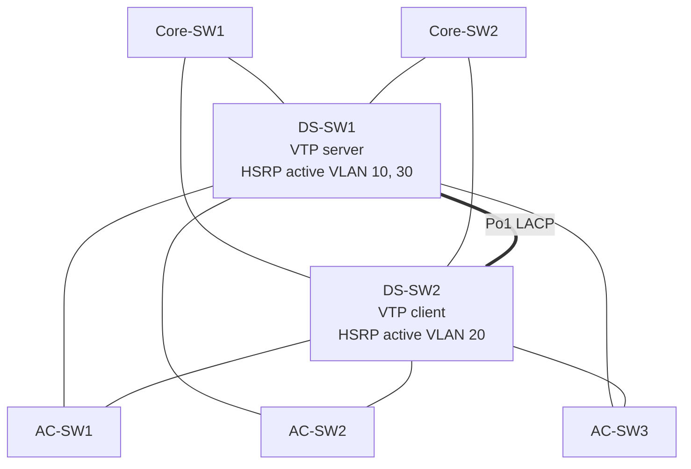

# Network as Code

[](https://github.com/Redis12/network-as-code/actions/workflows/ci.yml)

Au lieu de configurer chaque switch à la main, le réseau est **décrit dans des fichiers YAML**.
Des templates **Jinja2** génèrent les configurations Cisco, et un script **Python / Netmiko**
se connecte en SSH aux équipements pour **vérifier automatiquement** que le réseau
fonctionne comme prévu.

```
inventory/*.yaml ──► templates/*.j2 ──► configs/<switch>.txt ──► EVE-NG ──► verify.py
   (le réseau)         (les règles)       (configs Cisco)        (labo)     (tests SSH)
```

Projet personnel réalisé pendant ma 3e année de bachelier Réseaux et Télécommunications
(HE2B-ESI, Bruxelles).

## Le réseau modélisé

Bâtiment 1 du labo de cours « TrierDataCenter » (EVE-NG, images Cisco IOL).



| Élément | Détail |
|---|---|
| Distribution (DS-SW1, DS-SW2) | L3, SVI + HSRP (VIP en .3), Rapid-PVST, EtherChannel LACP Po1, uplinks /30 vers les cores, EIGRP AS 200 |
| Accès (AC-SW1 à 3) | L2, uplinks en DTP auto, ports PC en access + portfast |
| VLANs | 10 (192.168.14.0/24), 20 (192.168.24.0/24), 30 (192.168.34.0/24) |
| VTP | Domaine BAT1 : DS-SW1 server, les autres client |
| Management | 192.168.201.0/24 : DS .211-.212 (e1/3), AC .221-.223 (e1/0) |

## Structure

```
inventory/
  hosts.yaml              quels switches existent (groupe -> rôle -> switches)
  group_vars/all.yaml     valeurs communes à tout le réseau
  group_vars/batiment1.yaml   valeurs communes au bâtiment (VTP, VLANs, management)
  host_vars/<switch>.yaml     ce qui est propre à un switch (ports, HSRP, uplinks)
templates/
  bootstrap.j2            IP de management + SSH (à coller en premier, à la console)
  distribution.j2         config des switches de distribution
  access.j2               config des switches d'accès
inventory.py              lit et fusionne l'inventaire
generate.py               produit configs/<switch>.txt et configs/bootstrap/<switch>.txt
verify.py                 se connecte en SSH et teste le réseau
```

Les variables sont fusionnées **du plus général au plus précis** (`all` → `batiment1` →
`host_vars`), comme dans Ansible : la valeur la plus précise gagne.

## Règles de conception

Les règles réseau vivent **dans les templates**, pas dans les données :

- IP de SVI = `prefix` du VLAN + `host_octet` du switch
- Priorité HSRP 110 si le VLAN est dans `hsrp_active`, sinon 100
- Root STP primary sur les mêmes VLANs que HSRP Active (trafic aligné)
- Les VLANs ne sont créés que sur le serveur VTP

Ajouter un VLAN au bâtiment = ajouter 3 lignes dans `batiment1.yaml`.

## Utilisation

```powershell
py -m pip install -r requirements.txt
py generate.py          # demande le mot de passe SSH, génère configs/
```

1. Coller `configs/bootstrap/<switch>.txt` à la console de chaque switch (IP + SSH).
2. Coller `configs/<switch>.txt` (la configuration complète).
3. Lancer les tests :

```powershell
py verify.py
```

Exemple de sortie sur le labo :

```
=== DS-SW1 (192.168.201.211)
  OK     HSRP VLAN 10 : Active attendu
  OK     HSRP VLAN 20 : Standby attendu
  OK     HSRP VLAN 30 : Active attendu
  OK     STP VLAN 10 : root attendu
  OK     STP VLAN 20 : pas root attendu
  OK     STP VLAN 30 : root attendu
  OK     EtherChannel Po1 up avec 2 membres
  ÉCHEC  Voisin EIGRP Core-SW1 (échoue tant que les cores sont absents du labo)
  ÉCHEC  Voisin EIGRP Core-SW2 (échoue tant que les cores sont absents du labo)
  OK     Trunk sur e0/2
  OK     Trunk sur e0/3
  OK     Trunk sur e1/0
...
=== AC-SW1 (192.168.201.221)
  OK     Trunk sur e0/2
  OK     Trunk sur e0/3
  OK     Port e0/0 dans le VLAN 10
  OK     Port e0/1 dans le VLAN 20
```

## Sécurité

- **Aucun vrai mot de passe dans le dépôt** : le mot de passe SSH est demandé au lancement
  (ou lu dans la variable d'environnement `NAC_SSH_PASSWORD`).
- `configs/` est généré et ignoré par Git.
- `cisco123` (VTP) est un mot de passe de labo.
- Les images IOL ne proposent que des algorithmes SSH basés sur SHA-1 : `paramiko<5` est
  donc fixé dans `requirements.txt` (paramiko 5 les a supprimés). En production, on mettrait
  plutôt l'IOS à jour.

## Intégration continue

À chaque push, GitHub Actions installe les dépendances, génère toutes les configurations
(une variable manquante fait échouer le build grâce à `StrictUndefined`) et vérifie la
syntaxe des scripts.

## Avancement

- [x] Niveau 1 : génération des configs depuis le YAML
- [x] Bootstrap : IP de management + SSH
- [x] Niveau 3 : tests automatiques avec `verify.py`, validés sur le labo EVE-NG
- [x] CI GitHub Actions
- [ ] Niveau 2 : déploiement automatique des configs avec Netmiko
- [ ] Bâtiment 2 (VRRP, VTP transparent)
- [ ] Cores (Core-SW1, Core-SW2)

## Outils

Python · PyYAML · Jinja2 · Netmiko · Git / GitHub Actions · EVE-NG · Cisco IOS (IOL)
